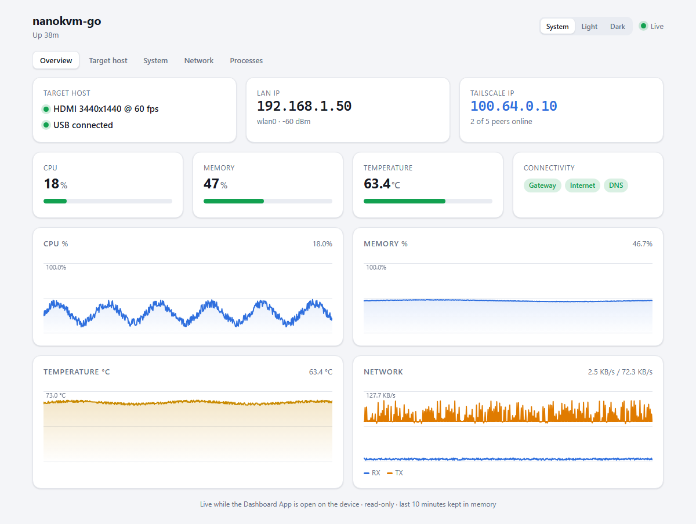
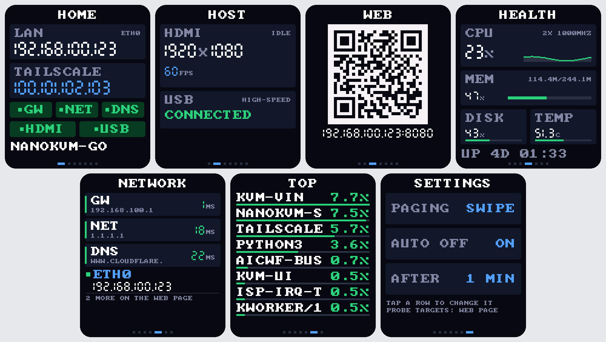
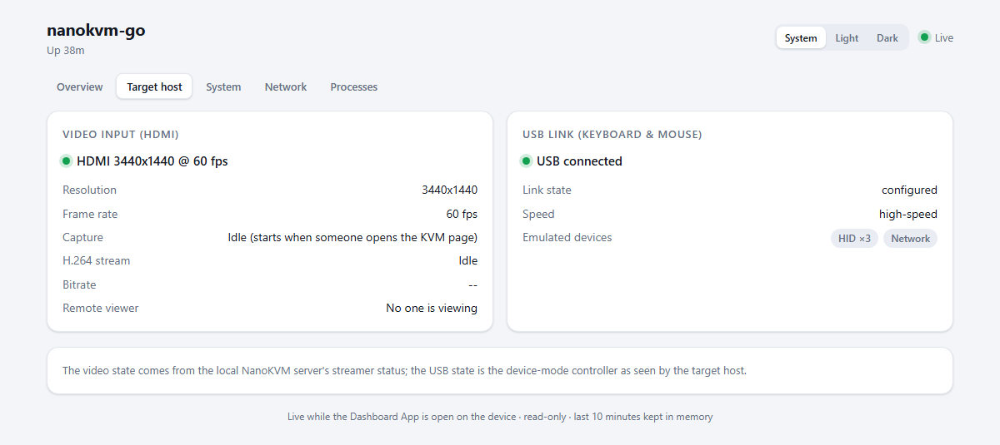
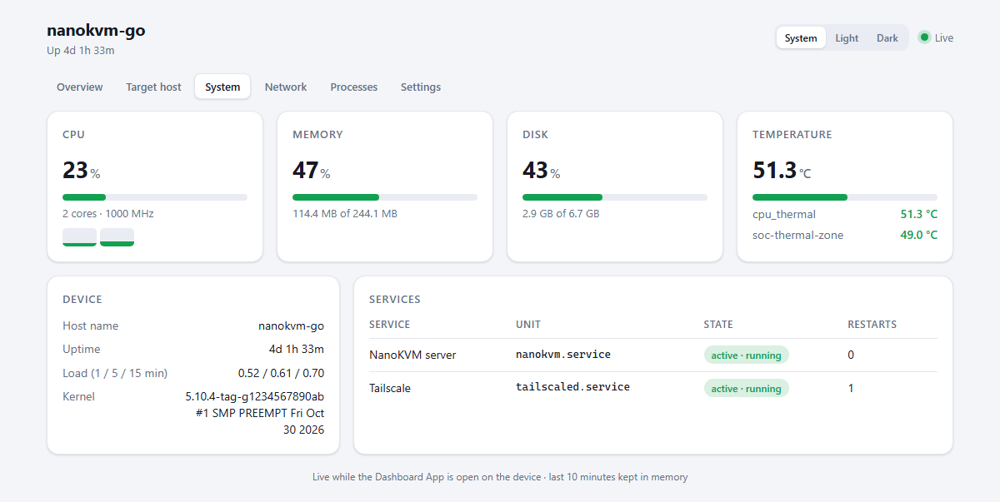
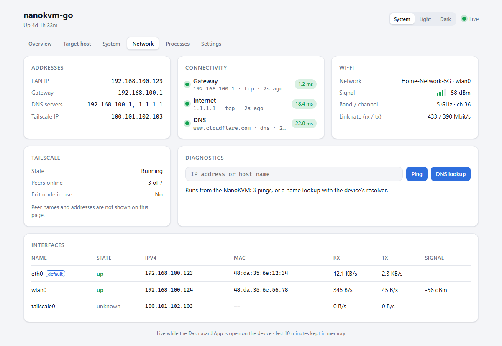
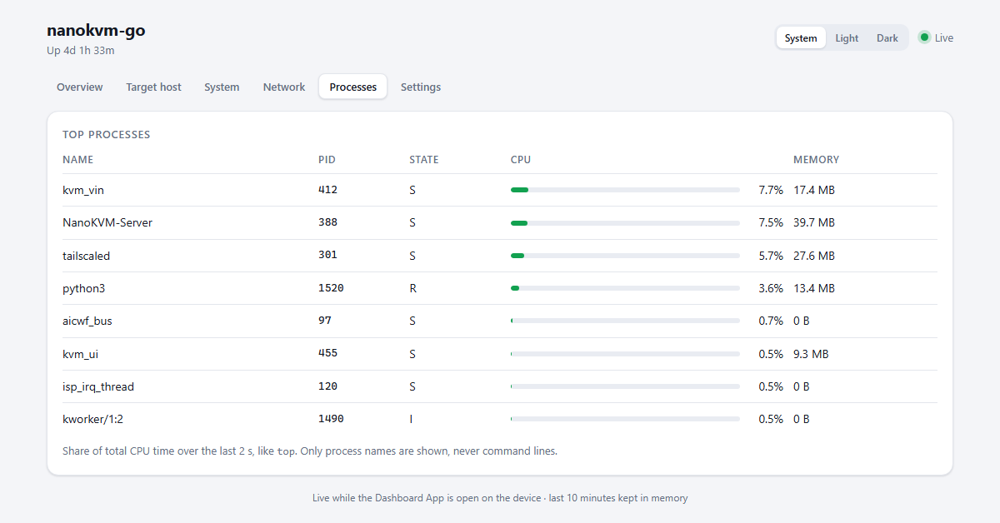
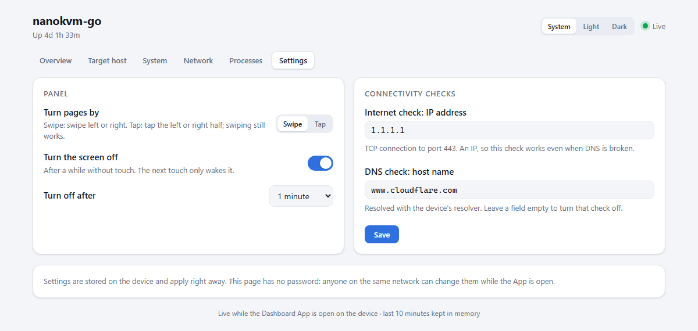
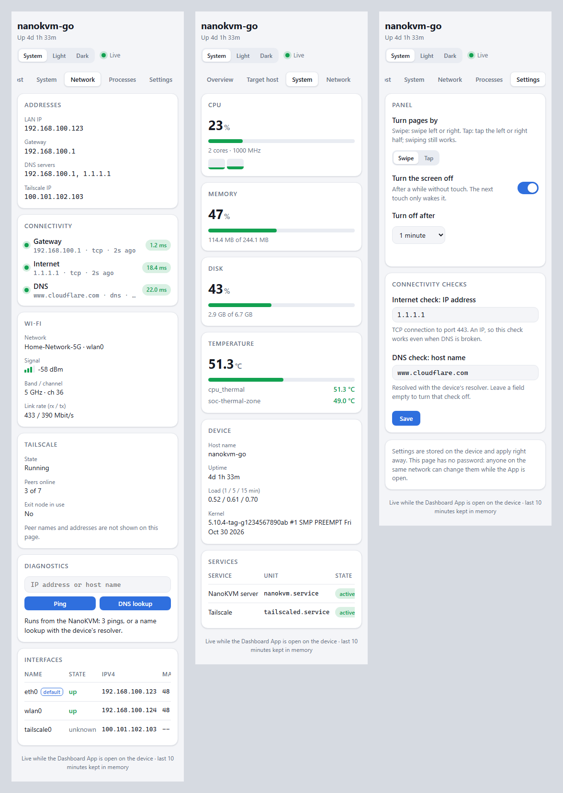
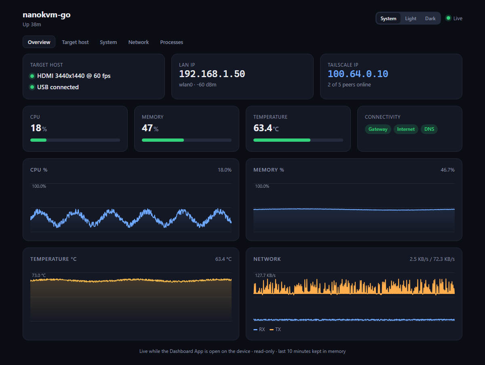

# Dashboard

[English](./README.md) | [简体中文](./README_zh.md)

A dashboard for the NanoKVM Go, on the panel and in a browser:

- **Target host:** HDMI input (signal, resolution, frame rate, H.264 stream,
  whether someone is viewing the KVM page) and the USB link that carries
  keyboard and mouse (connected or not, speed, emulated devices)
- **System:** CPU (total, per core, frequency), memory and swap, disk, every
  temperature sensor, load, kernel, and the state of the NanoKVM services
- **Network:** LAN and Tailscale IP, gateway, DNS servers, Wi-Fi (network,
  signal, band and channel, link rate), Tailscale state and how many peers are
  online, interfaces, connectivity checks, and ping / DNS lookup tools
- **Processes:** the busiest processes by CPU, like `top`
- **Settings:** how pages are turned, automatic screen off, and the targets
  of the connectivity checks, on the panel and on the web page

Logs and the names or addresses of other Tailscale devices are deliberately
not shown, because the page has no password.



## Panel

By default, swipe left for the next page and right for the previous one. With
**Tap** paging (see [Settings](#settings)), tap the right half of the screen
for the next page and the left half for the previous one; swiping still
works. The new page slides in from the side. Swipes that start at a side
edge stay reserved for the host's exit gesture.

The panel only reports a swipe once the finger lifts, so the page slides
after the gesture instead of following the finger.

| Page | Shows |
| --- | --- |
| HOME | LAN and Tailscale IP, gateway / internet / DNS and HDMI / USB status |
| HOST | HDMI resolution and frame rate, USB link state and speed |
| WEB | QR code that opens the web page |
| HEALTH | CPU with a sparkline, memory, disk, temperature, uptime |
| NETWORK | Gateway / internet / DNS latency and the active interfaces |
| TOP | Busiest processes |
| SETTINGS | Paging, auto screen off and its delay; tap a row to change it |

Large numbers use a small seven-segment face drawn with rectangles, which
stays readable on the panel; `qr.py` is a minimal QR encoder for the WEB page.



HDMI counts as connected when the NanoKVM reports a valid input resolution.
Capture itself only runs while someone has the KVM page open, so the HOST
page shows `IDLE` (and the web page "Capture: Idle") the rest of the time;
resolution and frame rate are still shown.

### Auto screen off

With auto screen off enabled (the default), the panel goes black after 1
minute without touch (30 seconds, 5 or 10 minutes can be chosen). The next
touch only wakes it and does not change the page. Sampling, the connectivity
checks and the web page keep running while the panel is dark.

`appbase` has no backlight control, so the screen is drawn black and not
redrawn until it wakes; the backlight itself stays on.

## Web page

While the App is open, open `http://<LAN IP>:8080/apps/dashboard/` from any
device on the same network, or scan the QR code on the WEB page;
`http://<LAN IP>:8080/` redirects there. The dashboard has six tabs
(Overview, Target host, System, Network, Processes, Settings), refreshes every
2 seconds and draws CPU, memory, temperature and network charts for the last
10 minutes. Theme can be System, Light or Dark, remembered per browser. It is
plain HTML/CSS/JS with no external resources, so it works without internet
access.

| Target host | System |
| --- | --- |
|  |  |
| **Network** | **Processes** |
|  |  |
| **Settings** | |
|  | |

On a phone, labels sit above their values, the tab bar scrolls sideways and
wide tables scroll inside their card, so nothing is squeezed into one-word
lines.

<details>
<summary>Phone and dark theme</summary>





</details>

The Network tab can run a ping (3 packets) or a DNS lookup from the device.
Targets must be an IP address or host name, one check runs at a time, and at
most one every 2 seconds.

The web server runs only while the App is open. Closing the App stops it and
frees the port, and the page then shows an "Offline" banner. Chart history is
kept in memory only and starts over each time the App is opened.

The built-in NanoKVM web server (ports 80/443) has no way for an App to add
pages without changing system files, so the App serves its own port. The page
uses relative URLs, so it also works behind a reverse proxy under any path.

Open the page by the device's IP address, its host name, `<host name>.local`
or its Tailscale MagicDNS name (`<host name>.<tailnet>.ts.net`); any other
name in the address bar gets `403`. This stops another web site from reading
the page or changing settings by pointing its own domain at the device (DNS
rebinding). A reverse proxy must therefore send one of those names (or the
IP) as `Host`. The `POST` endpoints also only accept `application/json`, so a
page on another site cannot post to them from your browser.

> **No password.** Anyone on the same network can read the page while the App
> is open, including IP and MAC addresses, Wi-Fi network name and process
> names, and can change the [settings](#settings). Logs, command lines and
> other Tailscale devices are never shown. Close the App when you don't need
> it.

JSON is available at `/apps/dashboard/api/status` (current snapshot plus
history newer than `?since=<seq>`), `/apps/dashboard/api/history` and
`/apps/dashboard/api/settings` (`GET` to read; `POST` a JSON object with the
settings to change). `POST` requests must be sent as `application/json`.

## Performance

The App only works while someone is looking: the panel is lit, or a web page
polled in the last 10 seconds. While the panel is dark and no page is open,
nothing is sampled, probed or drawn, and the App sleeps until a touch or a
web request. Charts show a gap for that time instead of made-up values; the
first web request after a quiet spell waits for a fresh sample (up to 1.5 s).

- **Sampling:** once per second, cheap `/proc` and `/sys` reads only.
- **Probes:** slow work (network checks, DNS, `ping`, `iw`, the local
  streamer status, `tailscale`) runs in a background thread every 5 seconds.
  Results older than 15 seconds show as unknown.
- **Web-only details:** services, Tailscale and DNS servers refresh every 15
  seconds, and the process list every 2 seconds. Both only run while a web
  page is open; the process list also runs while the TOP page is lit.
- **Panel:** each page is redrawn only when what it shows changed (HEALTH
  every second, the others usually far less often), and the framebuffer is
  only written after a redraw. Between samples the App waits on the touch
  device instead of polling it.
- **Web page:** every open page polls every 2 seconds, and pages in step share
  one encoded reply per sample. Settings come with that reply. A page in a
  hidden browser tab stops polling.

## Connectivity checks

Every 5 seconds, in a background thread:

| Check | Method |
| --- | --- |
| Gateway | TCP connect to port 80. A refused connection still counts as reachable. If the connection times out, `ping` is tried once when available. Without `ping` the result shows as unknown rather than failed. |
| Internet | TCP connect to the internet check IP (default `1.1.1.1`) port 443. |
| DNS | Resolves the DNS check host name (default `www.cloudflare.com`). A lookup taking more than 3 s counts as failed. |

## Settings

Change these on the panel's SETTINGS page or on the web page's Settings tab.
They are saved in `settings.json` in the App directory, kept across
restarts, and apply right away.

| Setting | Default | Where | Description |
| --- | --- | --- | --- |
| Turn pages by | Swipe | Panel, web | Swipe: left / right swipe. Tap: tap the left / right half; swiping still works. |
| Turn the screen off | On | Panel, web | Turn the panel off after a while without touch. |
| Turn off after | 1 minute | Panel, web | 30 seconds, 1, 5 or 10 minutes. |
| Internet check IP | `1.1.1.1` | Web | IP address for the internet check. An IP, not a host name, so this check does not depend on DNS. |
| DNS check host name | `www.cloudflare.com` | Web | Host name used for the DNS check. |

Leave the internet check IP or the DNS check host name empty to turn that
check off. If `settings.json` is missing or damaged, the defaults are used and
the problem is written to the App log.

The web port is set in the NanoKVM web UI under **Settings > Apps**:

| Variable | Default | Description |
| --- | --- | --- |
| `DASHBOARD_WEB_PORT` | `8080` | Port of the web page. If the port is busy, the panel shows `PORT ... IN USE` and keeps working. |

## Development

```bash
python -m unittest discover -s dashboard -p "test_*.py"
```

`collector.py`, `settings.py` and `slide.py` only use the Python standard
library and import on any OS. The collector's parsers take file text, so they
can be tested without a device; the slide tests use a fake framebuffer in
every rotation. `DASHBOARD_DEBUG=1` prints the longest sample-and-redraw
time every 10 seconds to stderr. The screenshots in `_docs/dashboard/` use
made-up addresses.
