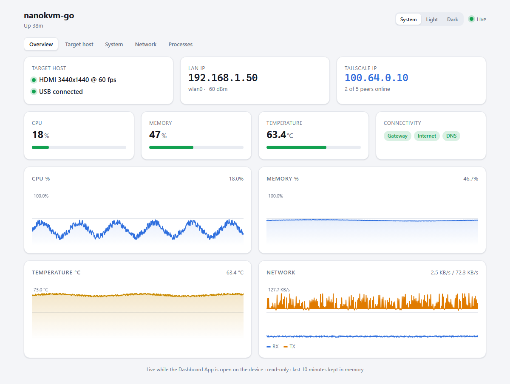
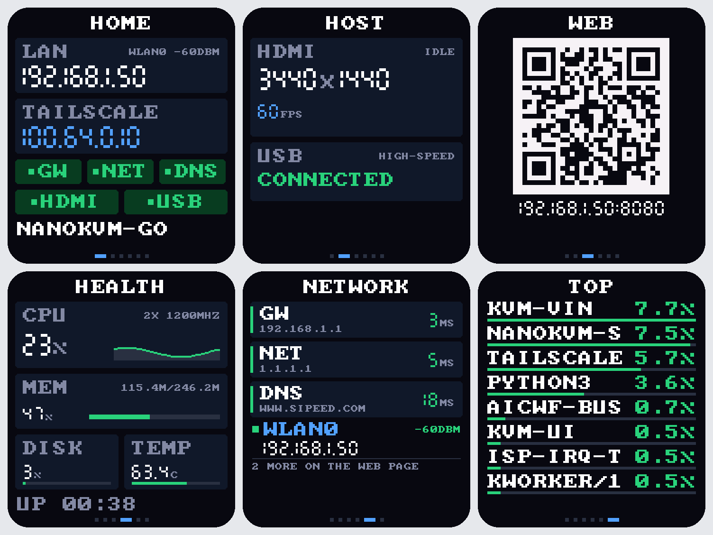
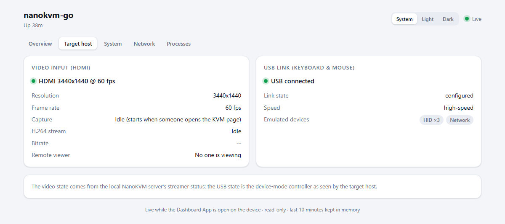
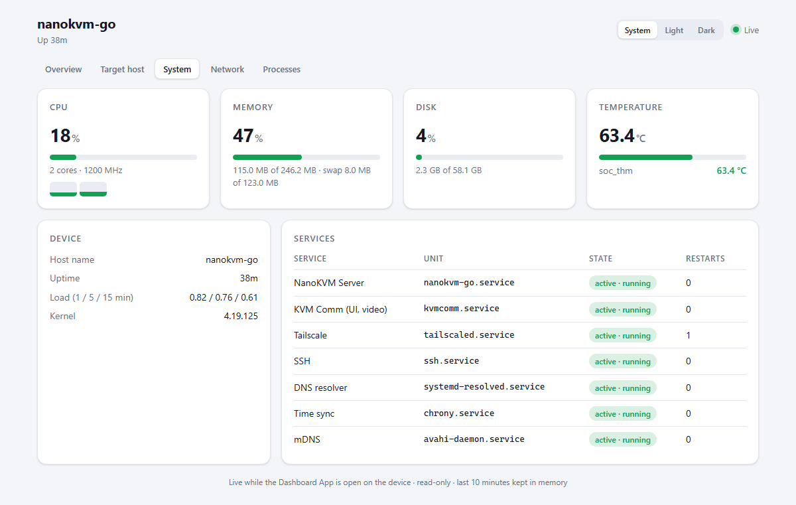
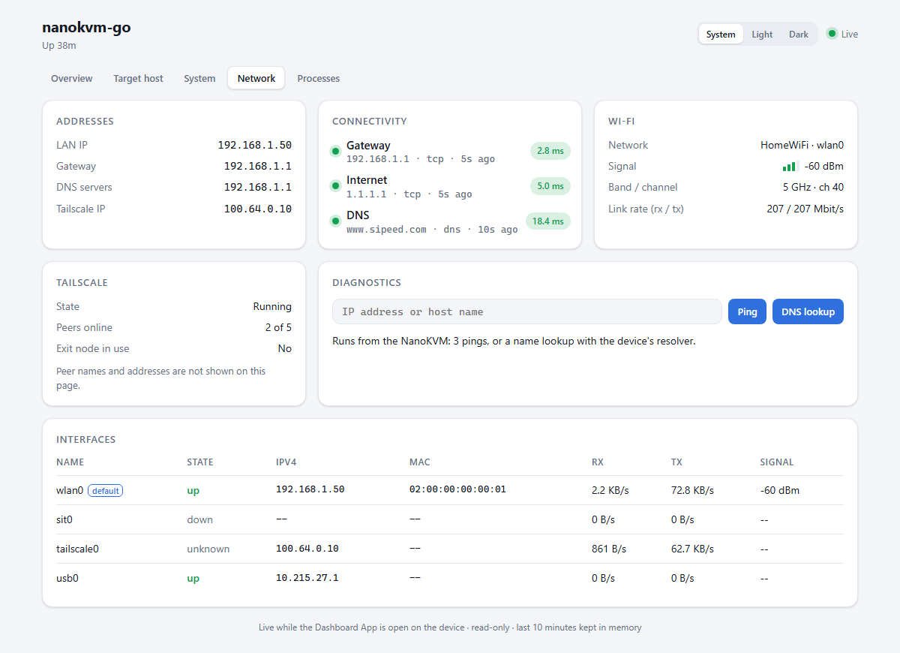
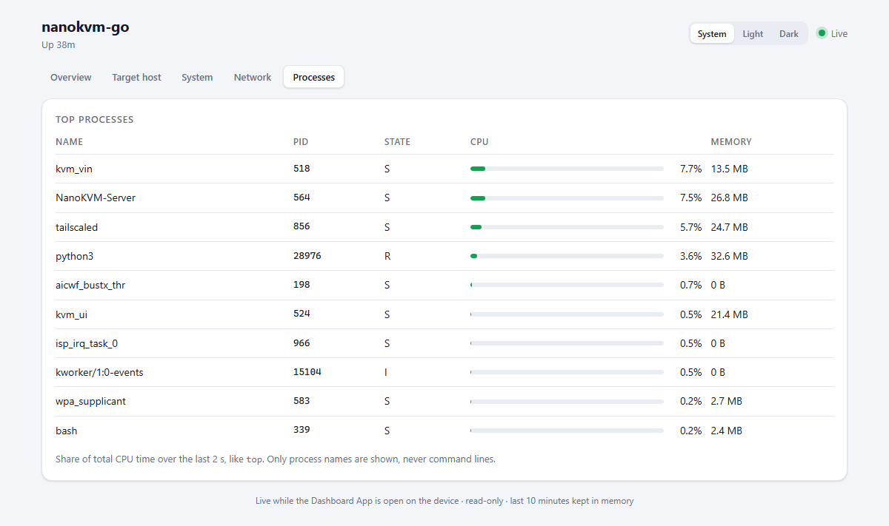
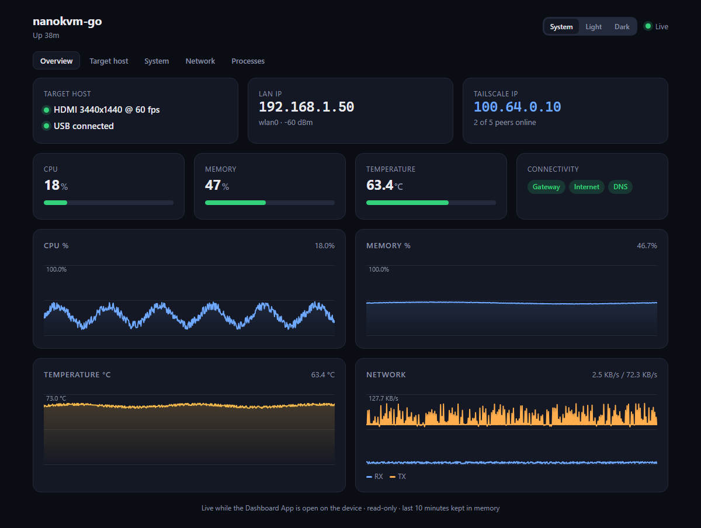

# Dashboard 仪表盘

[English](./README.md) | [简体中文](./README_zh.md)

NanoKVM Go 的只读 dashboard，在屏幕和浏览器上都能查看：

- **被控主机**：HDMI 输入（有无信号、分辨率、帧率、H.264 推流、是否有人在看 KVM 页面），以及传输键盘鼠标的 USB 连接（是否连接、速度、模拟的设备）
- **系统**：CPU（总占用、每核、频率）、内存和 swap、磁盘、所有温度传感器、负载、内核版本，以及 NanoKVM 相关服务的运行状态
- **网络**：LAN 和 Tailscale IP、网关、DNS 服务器、Wi-Fi（网络名、信号、频段和信道、连接速率）、Tailscale 状态和在线节点数、网卡、连通性检测，以及 ping / DNS 查询小工具
- **进程**：按 CPU 排序的进程（类似 `top`）

网页没有访问口令，所以日志和其他 Tailscale 设备的名称、地址都不会显示。



## 屏幕

点击屏幕右半边（或左滑、上滑）翻到下一页，点击左半边（或右滑、下滑）回到上一页。从屏幕侧边开始的滑动仍保留给系统的退出手势。

| 页面 | 内容 |
| --- | --- |
| HOME | LAN 和 Tailscale IP，网关 / 公网 / DNS 状态，HDMI / USB 状态 |
| HOST | HDMI 分辨率和帧率，USB 连接状态和速度 |
| WEB | 二维码，扫码打开网页 |
| HEALTH | CPU（带走势曲线）、内存、磁盘、温度、运行时长 |
| NETWORK | 网关 / 公网 / DNS 延迟，以及已启用的网卡 |
| TOP | 占用 CPU 最多的进程 |

大号数字用矩形绘制的七段数码管字体，在屏幕上更清晰；`qr.py` 是给 WEB 页用的精简二维码编码器。



只要 NanoKVM 报告了有效的输入分辨率，就认为 HDMI 已连接。视频采集只在有人打开 KVM 页面时才运行，其余时间 HOST 页显示 `IDLE`（网页上显示 "Capture: Idle"），但分辨率和帧率照常显示。

## Web 页面

App 打开期间，在同一局域网内用浏览器访问 `http://<LAN IP>:8080/apps/dashboard/`，或扫描屏幕 WEB 页的二维码；访问 `http://<LAN IP>:8080/` 也会自动跳转。

- 页面分 5 个标签：Overview、Target host、System、Network、Processes。
- 每 2 秒刷新一次，并绘制最近 10 分钟的 CPU、内存、温度和网速曲线。
- 主题可以选 System、Light 或 Dark，每个浏览器分别记住自己的选择。
- 只用原生 HTML/CSS/JS，不加载外部资源，没有外网也能用。

| Target host | System |
| --- | --- |
|  |  |
| **Network** | **Processes** |
|  |  |

<details>
<summary>深色主题</summary>



</details>

Network 标签页可以从设备上发起 ping（3 个包）或 DNS 查询。目标必须是 IP 地址或主机名，同一时间只能运行一个，并且至少间隔 2 秒。

Web 服务只在 App 打开时运行：
- 退出 App 后服务停止、端口释放，页面会显示"离线"提示；
- 曲线历史只保存在内存里，每次打开 App 都从零开始。

为什么用单独的端口：NanoKVM 自带的 Web 服务（80/443 端口）不支持 App 在不修改系统文件的情况下添加页面，所以 App 使用自己的端口。页面里的接口都用相对路径，以后放到反向代理后面、挂在任意路径下也能直接用。

> **没有访问口令。** App 打开期间，同一局域网内的任何人都能看到这个页面，包括 IP、MAC 地址、Wi-Fi 网络名和进程名。日志、命令行和其他 Tailscale 设备都不会显示。不用时请退出 App。

JSON 接口：
- `/apps/dashboard/api/status`：返回当前快照，以及 `?since=<seq>` 之后的历史；
- `/apps/dashboard/api/history`：返回全部历史。

## 性能

- 每秒采样一次，主循环里只读取开销很小的 `/proc` 和 `/sys` 文件。
- 慢操作（网络探测、DNS、`ping`、`iw`、本机推流状态、`tailscale`）都在后台线程里，每 5 秒一次。
- 只给网页用的信息（服务、Tailscale、DNS 服务器）每 15 秒刷新一次，进程列表每 2 秒一次；两者都只在有人打开网页时才采集（进程列表在屏幕停在 TOP 页时也会采集）。

## 连通性检测

后台线程每 5 秒检测一次：

| 项目 | 方法 |
| --- | --- |
| 网关 | TCP 连接 80 端口，被拒绝也算可达。连接超时时，如果设备上有 `ping`，就用 ping 再试一次；没有 ping 时显示"未知"，不会显示"失败"。 |
| 公网 | TCP 连接 `DASHBOARD_PROBE_HOST` 的 443 端口。 |
| DNS | 解析 `DASHBOARD_DNS_NAME`，超过 3 秒算失败。 |

## 配置

在网页 **Settings > Apps** 中设置：

| 变量 | 默认值 | 说明 |
| --- | --- | --- |
| `DASHBOARD_WEB_PORT` | `8080` | Web 页面端口。端口被占用时，屏幕上显示 `PORT ... IN USE`，其他功能照常运行。 |
| `DASHBOARD_PROBE_HOST` | `1.1.1.1` | 公网检测的目标 IP。只接受 IP，这样公网检测不依赖 DNS。 |
| `DASHBOARD_DNS_NAME` | `www.sipeed.com` | DNS 检测要解析的域名。 |

把 `DASHBOARD_PROBE_HOST` 或 `DASHBOARD_DNS_NAME` 设为空值，就会关闭对应的检测。
配置错误会写入 App 日志。

## 开发

```bash
python -m unittest discover -s dashboard -p "test_*.py"
```

- `collector.py` 只用 Python 标准库，在任何系统上都能导入；解析函数接收文本参数，不需要真机就能测试。
- 设置 `DASHBOARD_DEBUG=1` 后，每 10 秒向 stderr 打印一次最长的 tick 耗时。
- `_docs/dashboard/` 里的截图使用的是虚构地址。
